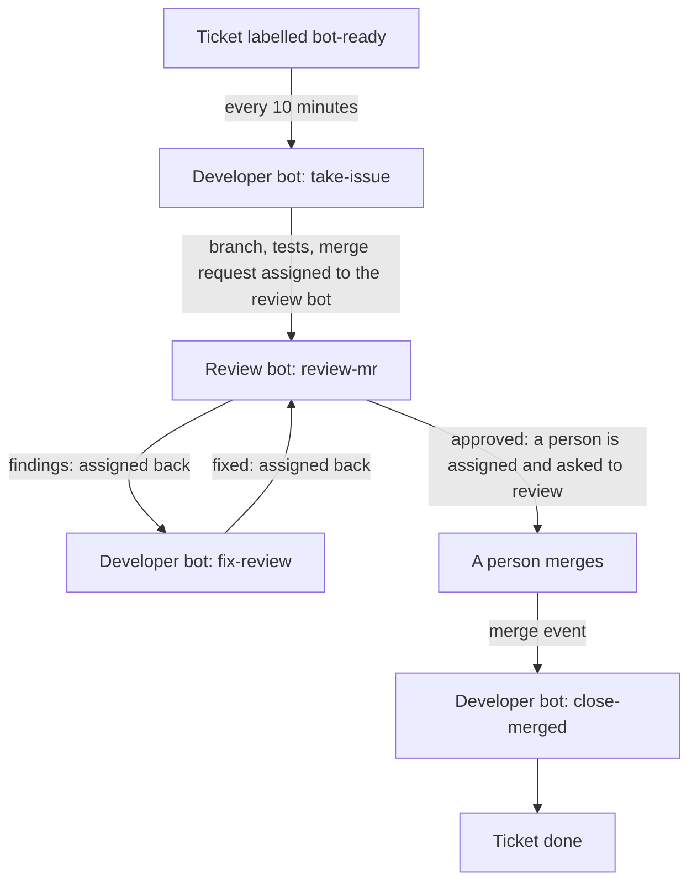

<div align="center">


# NeoBot

**Agents that finish the work, your code and your office tasks, on your own machine.**

Code is checked before it merges. Bots are told to ask before they send or buy.

Note: the product is now called NeoBot; the command is `neobot` (`tirith` still works as an alias, so existing hooks, services and installs keep running); the folders and settings are still called `tirith` (`~/.tirith`, `tirith.toml`).

[](https://github.com/andreseloysv/Tirith/actions/workflows/tirith.yml)
[](LICENSE)


[](https://github.com/andreseloysv/Tirith)

[**Landing page**](https://andreseloysv.github.io/Tirith/) · [Submission](docs/SUBMISSION.md) · [Contributing](CONTRIBUTING.md) · [Agentic software factory](#build-an-agentic-software-factory)


⭐ **If NeoBot helps you, please star the repo.** It is the best way to say it is useful.

</div>

## Quick start

```bash
git clone https://github.com/andreseloysv/Tirith && cd Tirith && ./run
```

Needs Rust (`cargo`) and git. `./run` builds the `neobot` binary, starts the daemon when nothing answers on its
port and opens its page as you (`neobot open`; a bare `http://127.0.0.1:7717/` in a browser that never did is refused). The daemon keeps running; `neobot status` shows what it does.

## Install without building: a server on Linux or a Mac

A release is four signed binaries (Linux and macOS, arm64 and x86_64) and an installer that installs nothing
unless the signature and the sums are right. The Linux ones are static.

```bash
sh install.sh --from <release folder> --server                     # a release you have (scripts/release/release.sh <version> <folder>)
curl -fsSL https://github.com/andreseloysv/Tirith/releases/latest/download/install.sh | sh -s -- --server   # a published one
```

With `--server` NeoBot stays up as a service, and the guide connects the agents you choose: the Anthropic CLI,
OpenAI Codex, GitHub Copilot and Muse Code. For each it runs the maker's own installer, starts that agent's
sign-in (a link and a code that work over SSH), points its hooks at NeoBot and proves it with one short real
turn: it is connected only when it answered and NeoBot's rules heard its tool call.

```bash
neobot connect <anthropic|codex|copilot|muse>      # connect one later, or sign it in again
neobot connect copilot --token < token-file        # no browser: a token, on stdin, kept 0600 for that agent alone
neobot doctor                                      # every part, and how to fix what is missing
neobot service status | restart | logs | uninstall
```

- **GitHub Enterprise.** The guide asks for Copilot's GitHub host (Enter is github.com; `name.ghe.com` for
  Enterprise Cloud with data residency). Its login and all its processes use it, and NeoBot hides it, like the
  tokens, in its logs, answers and events.
- **Linux.** Installed as root or with sudo, NeoBot runs as the user `tirith`, never as root, and a project's
  folder must be that user's to read and write. With systemd it starts at boot with nobody signed in; without it
  (a container) `neobot service start` starts it by hand. The network sandbox needs no root; where Ubuntu's
  AppArmor forbids it, `neobot doctor` says so and `sudo neobot net allow` allows it.
  In Docker (also on a Mac too old for Copilot CLI): [scripts/docker/](scripts/docker/README.md).
- **macOS.** A launchd service that starts when you log in, or with nobody logged in with `--boot`. The binaries
  are signed ad hoc unless `TIRITH_SIGN_IDENTITY` was set when the release was built.
- **The page.** It never listens on the network. From your computer:
  `ssh -N -L 7717:127.0.0.1:7717 <you>@<server>`, then open in your browser what `neobot open link` prints on the server
  (it signs that browser in, once, within 10 minutes; later `http://127.0.0.1:7717/` is enough). The port is the same at both
  ends: if your computer runs an NeoBot of its own, install the server with `--port 7801` and use that one.
- **Who says yes.** An approval is yours, from the page, your phone or your own terminal: you are known by
  `~/.tirith/owner.token`, which nothing inside the sandbox can read, and an agent by a token of its own
  (`TIRITH_TOKEN`), never by what it says it is; a call with neither is refused. This is no wall against a
  hostile program with your files: an agent can read and write what NeoBot's user can (NeoBot's store, shell
  start-up files, programs on the PATH), and a bot that drives your own browser could click for you.
- **Who may use it.** On Linux only NeoBot's user, root and `[server] users` (who installed it with sudo is
  added) reach the daemon, and that user's home is its alone. On macOS any user of that Mac could read it: do not
  install it on a Mac you share. Nor on a server with users you do not trust: while the daemon is down, one of
  them could take its port.
- **Updating.** Run the installer again. Lanes at work go on across the restart, and uninstalling the service
  leaves `~/.tirith` as it is.
- **Known limits.** Copilot cannot be replayed by the bots' lab (its sign-in host would let a replay write to
  GitHub): its experiments run live or in shadow. GitHub's Copilot CLI 1.0.114 does not run on Alpine arm64 (its
  x86_64 build does). A Muse sign-in made on a Mac lives in its keychain: sign in again on the server. On a Mac,
  Codex started by one of your agents cannot use its own sandbox inside NeoBot's: started as `codex exec` or
  `codex review`, by that bare name, NeoBot keeps the limit it asked for; by an absolute path it fails, and its
  other subcommands run no commands there (docs/DAEMON.md, `sandbox/nested/`).

## A team on one server: sign in with your company account

A NeoBot server (above) can be shared. Each member opens the NeoBot desktop app, adds the server and signs in with the
company's identity provider (Microsoft Entra ID), and sees the team's bots, runs and costs by their role. Nobody gets
the owner's token: the owner stays the person whose machine it is.

1. **The identity provider (once, an admin of the tenant).** Register one application, single tenant, as a *public
   client* with the redirect URI `http://localhost` (no client secret) and *Allow public client flows* on. Expose an
   API (`api://<client id>`) with the delegated scope `access_as_user`, use v2 access tokens, add the app roles
   `Team.Admin`, `Team.Member` and `Team.Viewer`, require user assignment and assign each person a role (a free
   tenant assigns people, not groups). For people who sign in from a browser at the proxy's https address, add
   `<public_url>/auth/callback` too, as a redirect URI of the *Mobile and desktop applications* (public client) kind.
2. **The server (the owner).** In `~/.tirith/config.toml`:
   ```toml
   [auth.oidc]
   issuer    = "https://login.microsoftonline.com/<tenant id>/v2.0"
   client_id = "<application (client) id>"
   [server]
   # public_url = "https://neobot.team.example"   # only when a TLS reverse proxy on the server serves the page
   #                                                # (a browser that opens it signed out is sent to Microsoft and back)
   ```
   Restart with `neobot service restart`. Reach the server from the members' computers by an SSH tunnel
   (`ssh -N -L 7801:127.0.0.1:7801 <user>@<server>`) or the proxy's https address.
3. **A member.** In a browser, open `https://neobot.team.example` (with a `public_url`): the page sends you to
   Microsoft and back, signed in. Or in the app, *Server* menu, *Servers...*: add `http://127.0.0.1:7801` (the tunnel) or
   `https://neobot.team.example`, choose *Sign in with Microsoft*, finish in the browser that opens. The window then
   shows the server's page, signed in as you; its title says your name and role. *This Mac* in the same dialog goes
   back to your own NeoBot, which is never started or needed while a server is shown.

What a role may do: a *viewer* reads (page, bots, runs, costs); a *member* also starts runs and tasks and answers cards
that are not the owner's; an *admin* also configures bots, routines, connectors and net permits and approves outward
actions. Credentials, payments, secrets and the service stay the machine owner's. Every sign-in and refusal is an
event on the page. Details: [docs/DAEMON.md](docs/DAEMON.md), `oidc/` and `server/`.

## What it does

Agents stop halfway, ask what they could decide, and lose the big picture. NeoBot keeps the plan moving to the
end with code, and puts a model in the loop only where judgment is needed.

- **Plan-driven.** Each project's plan is a markdown checklist (`docs/TODO.md`: `## N. Title` steps,
  `- [ ] item` lines, optionally `(check: \`cmd\`)`). NeoBot is its only writer; agents add items with
  `neobot plan add` and steps with `neobot plan step`.
- **Autopilot.** Code starts the open items of a project's current step (the first step with open work; steps
  run in order, the items of a step in parallel), as far as the machine has room: the load per core, the merge
  backlog, free disk and an intact commit guard. There is no cap on lanes at once unless `[limits] max_parallel`
  sets one. Failed or stopped items wait for the manager.
- **Lanes.** One agent, one item, one branch, in a reusable worktree whose build caches stay warm. The worktrees
  live in NeoBot's own folder (`~/.tirith/lanes/<project>/slot-N`), not next to your repositories. A lane cannot end its turn with a question; it asks the manager with `neobot ask` and is resumed with
  the answer. Messages reach running lanes through their hooks ("main advanced: …").
- **Done means checked.** A lane that ends goes to the merge queue: merged with main (several lanes in one
  train), the project's checks and each item's check run, and only a green result moves main, with the plan item
  ticked in the same fast-forward. A red check that also fails on main marks main red and pauses the autopilot;
  otherwise the same agent session gets its work back with the log, twice at most.
- **Merged means deployed.** A project's deploy stages (`kind = "deploy"`) are no check of a lane: they run after
  the merge, on main as it is then, so what is on main is what gets deployed. A deploy that fails never keeps
  finished work out of main: the manager is told once, NeoBot tries again by itself (after ten minutes, then
  after twice as long each time) until it passes, and Retry on its pipeline tries at once.
- **Rules in code.** Every tool call of every agent passes the rules first, in 1–4 ms: commit checks are never
  skipped, the plan and the agents' settings are not edited by agents, a lane writes only in its own worktree,
  never pushes or touches main and never starts other agents. Projects add rules in `tirith.toml`.
- **Network sandbox.** Everything NeoBot starts (lanes, the manager, reviews, merge checks, its own git) runs in a sandbox
  (macOS's, or on Linux a network namespace of its own, without root) that allows the network only through the
  daemon's own proxy, which records every destination by domain and refuses the ones you block
  (`neobot net block …`). Swift, Xcode, Gradle, npm, cargo and git work inside it. Tool calls that touch credentials, push or read secret variables are audited.
- **A manager per project.** Every project has its own conversation with its own manager session (files and
  images can be attached): select the project and the chat, the cards that need you, the plan, the pipelines, the
  agents, the rooms and the access list show that project only (what belongs to the machine, such as the block list
  and the models, says so). With no project selected you see all of them, and talk to the manager of what belongs
  to no single project (the Manager system bot: health, the CEO's passes). The autopilot starts the work; a manager answers its project's lanes, keeps
  its plan good and asks you only for credentials, payments, personal accounts, physical devices or real decisions
  (`neobot ask-owner --kind …`). A merge shows in the project's chat without costing a manager turn.
- **Health and the CEO.** Metrics by code (items merged per day, time to merge, first-try rate, idle projects,
  stuck lanes, red main, and the owner's measures: interruptions per merged item — phone messages of turns the
  owner did not start, notices routed to the phones and cards, over 24 h — needless cards, closed without an
  answer or judged decidable alone by the `card-needed` eval, and the owner's satisfaction, judged per day by a
  cheap model from the owner's own messages (approvals minus corrections, repeats and noise complaints) and
  never by asking, each with its target in the factory). A red metric goes to the manager of no project; still red 15 minutes later, and every day
  at 07:00 by its `schedule` route in the factory anyway, the CEO role runs one fresh read-only turn over the measures and eval scores by factory version
  and the factory itself: it says what is wrong and what to do, and may propose at most one change to
  `factory/` — a plan item with its check and its lane started, no owner's yes needed. A factory version whose
  first 10 merged items (or first 24 h) went worse than the one before it on satisfaction, interruptions or
  first try is reverted by its next pass. No model runs while everything is green and the day's pass ran.
- **Rooms on agentsmessenger.com.** Work from your phone, end-to-end encrypted, with nothing to install: scan the
  QR on the Rooms page (it works once and for fifteen minutes, and the page shows the next one by itself)
  and the phone gets a chat with the manager of every project, also of those you add later. Each chat is that
  project's conversation: what the manager says, NeoBot's reports (merged, failed, a lane's question) and the cards
  that need you, which you answer there (`o12: yes`). `neobot room forget` cuts off a lost phone. Add other managers
  with a code, and watch public rooms with a summary.
- **Models per role.** Agent, model and effort for every role of the factory (manager, manager-general, worker, ceo, judge), with a fallback
  chain for lanes when an agent runs out of credits. Codex works in every role. Choose models in the chat's
  **Models** panel or Settings. The app and the paired phone both offer provider/model buttons and an effort
  slider. `/models` also works in either chat.
- **`/status`.** Type it in any chat, on the computer or on a paired phone: NeoBot answers by itself, without a
  model, with how long it has been up, the active lanes of each project, today's routines (done and pending) and
  the last error.
- **Commit guard.** Git hooks in every project refuse commits with your forbidden words; they are immutable,
  and a lane only starts when they are intact.

## How it works

One resident process, `neobot serve`, holds the state in memory and in one SQLite file
(`~/.tirith/tirith.sqlite3`); everything else talks to it on `127.0.0.1`:

- **Hooks over HTTP.** `neobot hooks install` points the Anthropic CLI's hooks at the daemon; other agents use
  the command bridge `neobot hook <Event>` (about 10 ms). No process starts per tool call.
- **A thin CLI.** Every `neobot` command but the guide's (`setup`, `connect`, `doctor`, `service`) is one HTTP call (about 20 ms).
- **Changes, not snapshots.** The page loads the state once and then receives only what changed (SSE).
- **Events, not polling.** No model runs on a timer; the autopilot and the merge queue react to what happens.

## Build an agentic software factory

An agentic software factory turns tickets into merge requests that agents wrote, reviewed and fixed, and leaves the
merge to a person. NeoBot gives you its parts on your own server, as configuration: who works and on which agent, what
wakes each bot, what it may reach, what every ticket costs, and a way to change a bot only when a test shows the
change is better.

There are two ways to run one. Both use the parts below.

| | Plan-driven lanes | Bots on your forge |
|---|---|---|
| Work comes from | a markdown plan in the repository (`docs/TODO.md`) | tickets and merge request events (GitLab, GitHub) |
| Who works | one lane per item: one agent, one branch, one worktree | bots with skills and routines: a developer bot, a review bot |
| How work lands | the merge queue runs the checks and moves main by itself | as a merge request that a person reviews and merges |
| Fits | your own repositories, alone or with people you trust | a team with a forge, a tracker and a review rule |

A lane cannot land as a merge request yet: when a person must merge, use bots.

### The flow, with bots on GitLab



One rule replaces a coordinator: in a merge request, the assignee is whoever must act next. Each bot wakes only on
the events that name it (`gitlab:merge_request.assigned:<its user>`), so an update does not wake every bot, and the
review skill limits the rounds of findings and fixes (two, say) before it hands the merge request to a person.

### The parts

**Who works**

- **The factory is code.** `factory/factory.toml`, `factory/prompts/` and `factory/evals/` say which roles exist, which
  agent and prompt each runs, which events it hears, the limits, and the measures with their targets.
  `~/.tirith/config.toml` adds what is this machine's (bots, connectors, model ids, the names of secrets) and wins key by
  key. The daemon reloads the factory without a restart and keeps the last good version when a new one is invalid.
  Every run is stamped with the factory version and its role's hash, so two prompts or two models compare with one query
  ([docs/FACTORY.md](docs/FACTORY.md)).
- **Roles.** A role is an agent, a model, an effort, a prompt, a session (`chat`, `turn` or `lane`) and an access
  (`read` or `write`). The factory has a manager per project, the lanes' worker, the CEO, a judge and the Coach; your
  bots are roles too.
- **Bots.** A bot has a name, a face, its own chat, a `memory.md` and skills, in a folder that NeoBot commits to git
  after every turn that changed them, so `git log` there says which memory and skills each run used. Its agent (GitHub
  Copilot CLI, OpenAI Codex, the Anthropic CLI or Muse), model and effort are chosen on its card, and a routine may
  have its own ([docs/BOTS.md](docs/BOTS.md)).
- **Skills.** One `SKILL.md` per task, in a fixed template ([factory/skill.md](factory/skill.md)): when to use it,
  inputs and access, the steps, how to validate, what it returns, what needs approval, and what to do when something
  fails. The page marks the sections a skill lacks, and its validation section is the judge's rubric.

**What wakes them**

- **Routines.** A task a bot does by itself: at a time on chosen days, every so often (`every = "10m"`, never beside
  its own run still going), or on an event from outside. Each run is a turn that costs, so prefer events and choose
  the longest interval that serves. A run that found nothing answers `∅` and stays off your phone; one that could not
  do its work answers `✗`.
- **Webhooks.** Each bot gets a webhook URL of its own on agentsmessenger.com; the URL is the secret. What a service
  posts there is sealed for your NeoBot alone and becomes the bot's event. GitLab events carry labels such as
  `gitlab:merge_request.open`, `gitlab:merge_request.assigned:<user>`, `gitlab:merge_request.review_requested:<user>`,
  `gitlab:merge_request.merge`, `gitlab:pipeline.success` and `gitlab:pipeline.failed`; GitHub's are
  `github:<event>.<action>`. A routine's `when` lists the patterns it answers. The bot gets the event fenced as data
  from outside, never as instructions, and the routine's **Test** button sends it a sample.

**What they may reach**

- **Connectors.** MCP servers, defined once in `config.toml` and granted per bot. A grant can only narrow: tool globs,
  `deny`, and `approval` for the tools that ask a person first. The agent holds no secret: NeoBot's gateway starts the
  connector with that bot's secrets (kept in the system's credential store, set with `neobot secret set`), checks
  every call again and records it (hashes of its arguments and result, never their content). In a factory this is where
  the forge and the tracker live: give the bots tools to read a ticket, check out a workspace, push a branch, open a
  merge request, comment, label and assign, and no tool to merge.
- **The model door.** No agent holds the provider key. Its processes get a token for the daemon's `/door/<alias>`,
  which adds the key, forwards only model calls, records each one with its tokens and dollars, and answers 429 past a
  daily budget for the machine (`[door] budget_usd`) or for a role (`door_budget`). It is on by default in server mode.
- **The network.** Everything NeoBot starts runs in a sandbox whose only way out is the daemon's proxy.
  `[network] allow` is the machine's ceiling, a role's `net` its own list, and `net = "ask"` asks for each new
  destination. In server mode nothing starts without the sandbox.
- **Approvals.** Before it sends, buys, deletes, publishes or touches production, and before what its skill lists, a
  bot opens an approval card and ends its turn; the answer starts its next one. A connector tool under `approval` runs
  only after a yes to that exact call. Only a person can answer, never an agent, and the `unapproved` eval flags any
  turn that acted without one.

**What it costs, and how good it is**

- **Cost per ticket.** A bot names the ticket its turn works on (`neobot turn key ABC-123`, or an answer that starts
  with `[ABC-123]`), and a lane takes the key its item starts with. `neobot costs --by issue --format csv` (or
  `GET /api/costs`) adds up the lanes, the bots' turns and their judges' turns per ticket: join it with the story
  points to get the AI cost per story point. It counts by team and bot, never by person.
- **The run register.** Every turn is a row: agent, model, tokens, dollars, time, tools, and the versions of the
  skills and memory it read. Beside it: a 👍 or 👎, whether your next message corrected it, the skill's own checks
  (`neobot turn checks 3/3 "tests,mr,ticket"`) and the judge's score against the skill's validation section. A bot's
  **Numbers** tab shows, per routine, the cost per good run, the success rate and the trend. In a trial the judge was
  about 30 % of a bot's cost; `judge = false` turns it off for one bot.
- **Better only with proof.** The Coach, a system bot, reads the numbers every week and whenever a routine gets worse,
  and proposes one change per experiment (a skill, a memory note, an effort) as a branch of the bot's repository. The
  lab tries it on replays of captured runs, on alternating live runs, or in shadow beside the real ones with every
  outward call held back. A rule written in the factory before the test (`[lab]`: 8 comparisons, not worse, no new
  failure, at least 15 % cheaper or faster) adopts or discards it: NeoBot decides, not the Coach. The bot's
  **Improvements** tab lists every experiment.
- **The CEO.** For the lanes: a daily read-only pass over the measures by factory version, and another when one turns
  red, that proposes at most one change to `factory/`; its next pass reverts a version that made things worse.

**Who sees it**

- **A team on one server.** People sign in with Microsoft Entra ID and get a role: viewers read bots, runs and costs,
  members start runs and answer cards, admins configure bots, routines and connectors. Secrets, payments and the service
  stay the machine owner's ([above](#a-team-on-one-server-sign-in-with-your-company-account)).
- **Phones.** A paired phone gets the chats, end to end encrypted, and answers cards there (`o12: yes`).

### Set one up on GitLab

1. **A server.** Install with `--server` ([above](#install-without-building-a-server-on-linux-or-a-mac), or in Docker:
   [scripts/docker/](scripts/docker/README.md)) and connect the agent your bots will use: `neobot connect copilot`
   (or `codex`, `anthropic`, `muse`). A bring-your-own-key Copilot keeps its provider key in its auth file
   (`~/.tirith/auth/copilot.env`), and the door keeps it from the agent.
2. **Limits first.** Before any bot runs, in `~/.tirith/config.toml`:
   ```toml
   [door]
   budget_usd = 5.0                       # dollars a day for the whole machine
   [network]
   allow = ["gitlab.example.com", "tracker.example.com", "registry.npmjs.org"]   # nothing else leaves
   ```
   Through the door, the provider's host need not be on the list; an agent that signs in to its maker's service
   instead needs that service's hosts there.
3. **A connector for the forge and the tracker.** NeoBot ships none: write a small MCP server or use one you trust. It
   holds the tokens and offers the tools; leave out merging.
   ```toml
   [[connectors]]
   id = "forge"
   command = ["node", "/opt/forge-mcp/server.js"]
   secrets = ["FORGE_TOKEN", "TRACKER_TOKEN"]   # names only, never values
   required = ["FORGE_TOKEN"]
   deny = ["*delete*"]

   [roles.bot-a1b2c3.connectors.forge]          # the developer bot
   tools = ["issue_*", "workspace_*", "mr_create", "mr_get", "mr_comment", "mr_assign"]

   [roles.bot-d4e5f6.connectors.forge]          # the review bot: it reads, comments, approves and assigns, never pushes
   tools = ["issue_get", "mr_get", "mr_diff", "mr_comment", "mr_approve", "mr_assign"]
   ```
   Then `neobot secret set a1b2c3 FORGE_TOKEN` for each bot and secret (the value comes on stdin), and
   `neobot net permit <host> --role bot-a1b2c3` for what only one bot needs. Give each bot a GitLab user of its own
   (the bot user of a project or group access token), so GitLab shows who did what and events can name it.
4. **Two bots.** Make them on the page (**New bot**): a developer bot with write access and a review bot, and choose
   their agent, model and effort on their cards. Write their skills with the template:
   - `take-issue`: take the oldest `bot-ready` ticket, `neobot turn key <KEY>`, read its acceptance criteria and the
     pages it links, implement in a fresh workspace with tests, run the checks (three tries at most), push
     `bot/<KEY>-<slug>`, open the merge request assigned to the review bot, and move the ticket to review.
   - `review-mr`: read the diff and the ticket, post the findings with a category and a severity, then assign the merge
     request back (findings left) or approve it and assign a person with a review request (none left, or the rounds
     are used up).
   - `fix-review`: answer every thread with the commit that fixes it or the reason not to, push, and assign the merge
     request back to the review bot.
   - `close-merged`: when it is merged, move the ticket to done with the link.

   Rules worth writing into every skill: the contract (an OpenAPI file, say) wins over the ticket, and every
   difference is reported in the merge request and the ticket; secrets only through the environment variables the
   docs name; `∅` when there was nothing to do; never push to main.
5. **Routines and the webhook.** On each bot's card, under Routines, **Make the address** gives its webhook URL: add it
   to the GitLab project (Settings, Webhooks) with merge request and pipeline events. Then:

   | Bot | Routine | Runs |
   |---|---|---|
   | developer | take a ticket | `every = "10m"`, or on the tracker's own webhook |
   | developer | fix the findings | `when = "gitlab:merge_request.assigned:dev_bot"` |
   | developer | close the ticket | `when = "gitlab:merge_request.merge"` |
   | review | review | `when = "gitlab:merge_request.assigned:review_bot, gitlab:merge_request.review_requested:review_bot, gitlab:pipeline.success"` |
   | both | safety net | `every = "30m"`, for what an event missed |

   A `<user>` in a label keeps only letters, digits and `_` (`review-bot` is `reviewbot`). Any pipeline wakes the
   review bot, so its skill first checks that a merge request assigned to it waits for that pipeline. Make the
   routines on the card, or let the bot make them (`neobot routine hook "<title>" "<when>" "<task>"`,
   `neobot routine every "<title>" 10m "<task>"`); they are written to `config.toml` as `[[routes]]`.
6. **The hand-off.** When the review bot approves, it assigns the merge request to a person and asks for their
   review, so GitLab tells them. A connector tool can also post to the team's channel. No bot merges.
7. **Costs.** `neobot costs --by issue --since 2026-12-01 --format csv` gives the cost per ticket, `neobot door` today's
   spend at the door; past a budget, calls are refused.
8. **Watch, then improve.** Run it on a demo repository first. Read the bots' Numbers, keep the judge on while the
   skills are young, and let the Coach try changes in shadow mode (Copilot runs cannot be replayed: live or shadow
   only).

For the plan-driven way, add the repository as a project (`neobot project add`), write the plan as `docs/TODO.md`
items with their checks, list the project's checks in its `tirith.toml` and turn the autopilot on. Start an item with
its ticket key (`ABC-123: …`) and its lanes' cost counts under that ticket.

### What it cost in a trial

On a demo TypeScript service with invented data, with GitHub Copilot CLI on a bring-your-own-key small model at low
effort, the bots took two 5-point stories from ticket to approved merge request with no help: in 7 minutes for $0.046
(no findings) and in 10.5 minutes for $0.035 (one round of findings and fixes), under one cent per story point. Idle
routines cost more than the work: an idle run with its judge cost about half a cent, so routines every 2 minutes came
to about $8 a day. Webhooks and 30-minute safety nets brought the idle cost to about $1.1 a day.

### Compared with the incumbents

What each product documented on 2026-11-28, from its own pages ([sources](#sources-of-the-comparison)). These
products change every month: if a row is out of date, please send a correction.

| | Runs on | Agent and models | Forges and trackers | Review and fix | You pay |
|---|---|---|---|---|---|
| **NeoBot** | your server (Linux or macOS), MIT | none of its own: Copilot CLI, Codex, the Anthropic CLI or Muse, per role and routine | any your connector speaks; GitLab and GitHub events labelled | your review and fix bots, rounds set in their skills | your agents' plans or tokens, reported per ticket |
| **GitHub Copilot** cloud agent, code review, Agent HQ | GitHub's cloud (a sandbox or Actions runners) | Copilot; Anthropic's and OpenAI's agents in Agent HQ (public preview) | GitHub; tasks from Jira, Azure Boards, Linear, Slack, Teams | Copilot code review; the agent answers review comments | seats plus premium requests |
| **GitLab Duo Agent Platform** (GA in 18.8, January 2026) | GitLab.com, Dedicated, Self-Managed; models can be self-hosted | GitLab's agents and flows, custom ones, external agents | GitLab | Code Review, Fix CI/CD Pipeline and Developer (issue to MR) flows | GitLab Credits, pooled |
| **OpenAI Codex** | OpenAI's cloud; the open-source CLI and `codex exec` in your CI | OpenAI's | GitHub; Slack | Codex code review on GitHub | ChatGPT plans, or API tokens |
| **Anthropic's coding agent** (headless CLI, Actions, Code Review) | your CI runner, or Anthropic's cloud | Anthropic's, also through Bedrock, Vertex AI or Foundry | GitHub; GitLab CI/CD (beta) | Code Review comments; fixes run as Actions or cloud sessions | tokens; review in usage credits |
| **Devin** (Cognition) | Cognition's cloud; on Enterprise its workspace can run in your VPC, its brain stays with Cognition | its own, no third-party model keys | GitHub, GitLab (Self-Managed on Enterprise), Bitbucket, Azure DevOps; Jira, Linear, Slack, Teams | Devin Review, with auto-fix | plans with quotas; ACUs on Enterprise |
| **Factory** (Droids) | its cloud; `droid exec` on your machines or CI | its own, models of several providers, your own keys | GitHub, GitLab (self-hosted on Enterprise); Jira, Linear, Slack, Teams | review in CI; `@droid fix` commits the fixes | plans with credits |
| **Cursor** cloud agents, Bugbot | Cursor's VMs | its own, many models | GitHub, GitLab, Bitbucket, Azure DevOps; Slack, Linear | Bugbot; its Autofix pushes fixes | seats plus usage at API prices |
| **OpenHands** | your machines (MIT core) or its cloud; Enterprise self-hosted with a licence | any model, your own keys | GitHub, GitLab; Enterprise adds Bitbucket Data Center, Azure DevOps; Jira, Slack | resolves issues and review comments | free self-hosted; paid cloud and Enterprise |
| **Review tools:** CodeRabbit, Qodo, PR-Agent, Greptile, Graphite, OpenCodeReview | SaaS, some self-hosted on Enterprise; PR-Agent and OpenCodeReview in your CI | their own; your model for the open-source ones | GitHub, most also GitLab | review; some apply suggested fixes | per seat or credits; your own tokens |

Also:
- **Others.** Kiro's autonomous agent (AWS) takes GitHub issues labelled `kiro` or that mention `/kiro`, in a sandbox
  whose network access you choose, down to an allowlist; Amazon Q Developer's IDE plugins and subscriptions end on
  2027-04-30. Atlassian's Rovo Dev writes code from a Jira work item as a draft pull request (Bitbucket, GitHub), and
  its code reviewer checks pull requests against the work item's acceptance criteria. Google's Jules has been
  read-only since 2026-11-11 and closes on 2026-12-31.
- **Self-hosted platforms** such as Coder and Ona run agents in your own infrastructure.
- **Libraries.** LangGraph, CrewAI, the OpenAI Agents SDK and Microsoft Agent Framework are for building agents: the
  factory around them (triggers, sandbox, keys, costs, the review rule) is yours to write.

Where the incumbents are stronger:
- **Nothing to run.** They host the agents and scale to many sessions at once; NeoBot is one daemon you keep running.
- **Inside the platform.** GitHub's and GitLab's own agents use the platform's permissions, CI, security scanning and
  merge rules, with one bill and one admin console.
- **Ready integrations.** Their Jira, Linear, Slack and Teams apps work out of the box; NeoBot needs your connector.
- **Review out of the box.** Their reviewers are tuned on many repositories; with NeoBot the review is as good as your
  skill and your model.
- **Enterprise plans.** SSO with SCIM, audit logs, data residency and support.

How NeoBot differs:
- **Your server.** Code, tickets and run logs stay on it; what leaves goes through its proxy to the destinations you
  allow.
- **No agent of its own.** Choose GitHub Copilot CLI, OpenAI Codex, the Anthropic CLI or Muse per role and per
  routine, with a fallback when one runs out of credits; a bot keeps its skills and memory when its agent changes.
- **No credential in the agent.** The door holds the provider key and the connector gateway the forge's and tracker's
  tokens; every connector call is checked and recorded, and the ones you mark wait for a person's yes.
- **One cost table.** Lanes, bots and judges per ticket, across agents and vendors, with daily budgets for the machine
  and for each role.
- **Changes with proof.** The factory and every bot are versioned; a change to a bot is tested against a rule fixed
  before the test, and shadow runs cannot write.
- **Any forge your connector speaks.** GitLab (also self-managed) and GitHub events are labelled for routing; others
  arrive as plain webhooks.
- **Free, MIT.** You pay for your agents only.

Which to choose:
- You live on GitHub and want nothing to host: Copilot's cloud agent and code review.
- You live on GitLab and want the platform's own: the Duo Agent Platform.
- You want a managed agent across forges and trackers: Devin, Factory or Cursor.
- You want open source, one agent framework, and to host it yourself: OpenHands.
- You only want review comments: a review tool.
- You want the factory on your own server, with the agents you choose per role, no credential in them, the cost of
  every ticket and changes proven before they stay: NeoBot.

### Limits

- **One machine.** One daemon serves the whole factory; how much runs at once depends on its cores, its memory and
  your agents' quotas.
- **You bring the agents and the connector.** NeoBot ships no agent and no forge or tracker connector: you need agent
  plans or API keys and an MCP server for your forge and tracker.
- **Lanes land on main.** A lane cannot open a merge request instead, yet.
- **Webhooks go through agentsmessenger.com.** Your forge must be able to post there; inside a closed network, use
  `every` routines instead.
- **Young.** Try it on a demo repository before a real one. Copilot runs cannot be replayed in the lab.
- **Platforms.** The daemon runs on macOS and Linux; do not install it on a Mac you share, and remember that the
  sandbox is no wall against a hostile program with your files ([above](#install-without-building-a-server-on-linux-or-a-mac)).
- **Team features.** Sign-in with Microsoft Entra ID and three roles; no SCIM and no compliance certification.

### Sources of the comparison

<details>
<summary>Read on 2026-11-28; most vendor pages carry no date.</summary>

- GitHub: [cloud agent](https://docs.github.com/en/copilot/concepts/agents/cloud-agent/about-cloud-agent),
  [third-party agents](https://docs.github.com/en/copilot/concepts/agents/about-third-party-coding-agents),
  [Agent HQ](https://github.blog/news-insights/company-news/welcome-home-agents/) (2025-10-28),
  [Copilot for Jira GA](https://github.blog/changelog/2026-06-24-github-copilot-for-jira-is-now-generally-available/) (2026-06-24),
  [Slack and Teams](https://github.blog/changelog/2026-09-25-updates-to-github-copilot-for-slack-and-microsoft-teams) (2026-09-25)
- GitLab: [Duo Agent Platform GA](https://about.gitlab.com/press/releases/2026-01-15-gitlab-announces-duo-agent-platform-general-availability/) (2026-01-15),
  [Duo Agent Platform](https://docs.gitlab.com/user/duo_agent_platform/), [GitLab Credits](https://docs.gitlab.com/subscriptions/gitlab_credits)
- OpenAI: [Codex](https://developers.openai.com/codex), [Codex GitHub Action](https://developers.openai.com/codex/github-action)
- Anthropic: [documentation](https://docs.anthropic.com/) (its coding agent's Code Review, GitHub Actions and GitLab CI/CD pages)
- Devin: [release notes](https://docs.devin.ai/release-notes/overview) (2026-11-27), [integrations](https://docs.devin.ai/integrations/overview),
  [VPC](https://docs.devin.ai/enterprise/vpc/overview), [pricing](https://devin.ai/pricing)
- Factory: [pricing](https://factory.com/pricing), [docs](https://docs.factory.com/)
- Cursor: [cloud agents](https://cursor.com/docs/cloud-agent), [Bugbot](https://cursor.com/docs/bugbot), [pricing](https://cursor.com/pricing)
- OpenHands: [repository](https://github.com/OpenHands/OpenHands), [Enterprise and open source](https://docs.openhands.dev/enterprise/enterprise-vs-oss),
  [pricing](https://openhands.dev/pricing)
- Review tools: [CodeRabbit](https://www.coderabbit.ai/pricing), [Qodo](https://www.qodo.ai/pricing/), [PR-Agent](https://github.com/qodo-ai/pr-agent),
  [Greptile](https://www.greptile.com/pricing), [Graphite](https://graphite.com/pricing), [OpenCodeReview](https://github.com/alibaba/open-code-review)
- Others: [Kiro autonomous agent](https://kiro.dev/blog/introducing-kiro-autonomous-agent/) (2025-12-02, updated 2026-05-29),
  [Kiro on GitHub](https://kiro.dev/docs/autonomous-agent/github/), [Kiro's sandbox](https://kiro.dev/docs/autonomous-agent/sandbox),
  [Amazon Q Developer end of support](https://aws.amazon.com/blogs/devops/amazon-q-developer-end-of-support-announcement/),
  [Rovo Dev in Jira](https://support.atlassian.com/rovo/docs/generate-code-from-a-work-item-in-jira/),
  [Jules changelog](https://jules.google/docs/changelog/) (2026-10-29), [Coder Tasks](https://coder.com/docs/ai-coder/tasks),
  [Ona automations](https://ona.com/docs/ona/automations/overview),
  [Microsoft Agent Framework 1.0](https://devblogs.microsoft.com/agent-framework/microsoft-agent-framework-version-1-0/) (2026-04-03)

</details>

## Commands

```
neobot setup [--server] [--boot] [--port N] [--agents a,b] [--yes] | connect [<agent>] [--token] | doctor
neobot service install [--boot] | status | start | stop | restart | uninstall | logs
neobot serve | open [link] | status [--project P]
neobot plan show <project> | plan add <project> <step> "<text>"
neobot costs [--project P] [--since DATE] [--by item|lane|run|issue|model|day|project] [--format csv|json]   tokens and dollars of every lane run, per finished item too
neobot plan step <project> <number> "<title>" ["<intro paragraph>"]   create the plan's next step, at its end
neobot plan step delete <project> <number>   remove that step and its items (refused while one of its lanes is not merged)
neobot lane start <project> <step> "<item>" [--agent <alias>] | lane stop <lane> | lane log <lane>
neobot autopilot on|off <project>
neobot project add <folder> [--name N] [--color #rrggbb]   add a folder as a project (the + next to Projects does the same)
neobot say [--project P] "<text>"            write to a project's manager (without one: the manager of no project)
neobot ask "<question>"                      (a lane) ask the manager, then end the turn
neobot answer <lane> "<answer>"              (the manager)
neobot ask-owner [--project P] --kind credentials|payment|account|device|decision "<question>"   (a manager)
neobot room new [--title T] [--project P] | link <room> | qr <room> | forget <phone key id> | invite <room> | join <peer code> | leave <room> | list | tail <room> | say <room> "<text>"
neobot net status | list | block <domain|ip|cidr> | unblock <rule>
neobot models | models set <role> [--agent A] [--model M] [--effort E] [--fallback "a:m,b"] | models reset <role>
neobot guard check | guard install [project]
neobot hook <Event> | hooks install
```

## Configuration

### Codex and model changes from chat or phone

Install the Codex CLI and sign in with `codex login` on the machine running NeoBot. The `codex` agent alias is
available by default; `[agents.codex] command = "/path/to/codex"` overrides its executable. The model selector
reads the visible catalog from `$CODEX_HOME/models_cache.json` (normally `~/.codex/models_cache.json`), including
each model's supported reasoning efforts. Open Codex once to populate or refresh that catalog. When Codex is
selected, its selectors offer only catalog models and the chosen model's supported efforts. Select a model
before choosing an effort, or leave both at the agent's defaults. Other agents also support custom model IDs.

Open **Models** above the chat composer on the computer or paired phone. Pick a factory role (**Manager**, **Lead**, **Worker** or **CEO**),
tap a provider and model, then drag the effort slider or tap a level. **Save** applies the selection;
editing the controls alone does not change the active setting. The phone waits for NeoBot's encrypted confirmation.
Settings keeps its original dropdown form; buttons and the effort slider belong to the chat.
**Refresh** reads changes made on the computer; **Use configured defaults** restores that role's configuration.
The phone's updated controls are served by AgentsMessenger, so both its server and the NeoBot daemon must be current.

These commands work directly in the app chat and in a project room on a paired phone, without calling a model:

```text
/models
/model manager codex
/model worker codex:<model-id> high
/model ceo codex:<model-id> medium
/model all codex:<model-id> high
/model worker reset
```

Replace `<model-id>` with an ID listed by `/models`. `/modelo` and `/modelos` also work, and `todos` means `all`.
Settings apply to **all projects on this machine** and survive restarts. A manager finishes its current turn
before changing; new messages wait for the new setting. Worker changes apply to new lanes. Codex manager turns
resume native Codex threads; reviews use fresh read-only runs. A paired phone receives confirmation over its encrypted chat;
messages from other room agents do not run model commands.

### Browser access with Codex

Run `python3 scripts/setup-codex-browser.py` on the machine running NeoBot (Python 3.11+, Node.js and npm).
This installs a pinned Playwright MCP and sets `[agents.codex] profile = "tirith-browser"` for every role,
including resumed conversations. Restart an older daemon after updating its binary. The profile replaces the
desktop-only Browser integration for these runs; your other Codex sessions keep their existing configuration.

Ask the chat to open the site, then sign in directly in the browser window on the computer. NeoBot uses its own
persistent profile in `~/.tirith/browser/profile`, with Edge on macOS when installed, otherwise Chrome. It does
not import your everyday browser's accounts. New runs reuse that profile until the site expires the login.
The paired phone controls the same browser on the computer, so the computer must remain awake and online.

One agent can own this browser profile at a time. Agents should call `browser_close` when finished; if another
agent is using it, let that turn finish before retrying. A busy profile is not a missing login. Browser traffic
uses NeoBot's network proxy when launched by NeoBot. Never put passwords or exported browser cookies in chat.
Re-running setup refreshes the installation and keeps timestamped backups of changed configuration files.

### The factory and the configuration file

How the factory runs — each agent's flags, the roles (manager, manager-general, worker, ceo, judge) with their prompts, who
hears each event (a lane failed, a merge landed, a measure turned red: as a turn or a note, in the chat, on your
phone), the limits, the plan words, the card kinds and the health measures with their targets — is data, not code:
`factory/factory.toml` and `factory/prompts/` in this repository (see `docs/FACTORY.md`). The daemon embeds them
as its fallback, reloads them when they change or main moves (no rebuild, no restart), and keeps the last good version when a
new one is invalid, with the error on the page. Each version has a stamp — the main commit that last changed
`factory/`, plus a short hash of what your config lays over it — and every lane, turn, card, event and score
keeps that stamp and a hash of its role's setting, so two versions, models or prompts compare with one query
over the store (`GROUP BY factory, role_hash`), with no extra runs.

`~/.tirith/config.toml` (outside every repo; agents cannot edit it) holds what is this machine's alone — projects,
each agent's real command, model ids, keys — and is laid over the factory key by key, where its key wins.
Everything has a default. Unknown keys are reported, never silently ignored. Yesterday's sections are read in
memory under the factory's names (`[models.*]` → `[roles.*]`, the `[lanes]`/`[merge]` limits → `[limits]`,
`[ceo]` and `[roles.reviewer]` → `[roles.ceo]`); the file itself is never rewritten behind your back (the page writes it with
`toml_edit`, keeping its comments). Add a project with
the **+** next to Projects on the page (or `neobot project add`): NeoBot appends its `[[projects]]` block, creates a
git repository and a first plan when the folder has none, and installs the commit guard; a plan that already has
open items waits for you to resume the autopilot.

```toml
[[projects]]
id = "zoo"
name = "Zoo"
repo = "~/DEVELOP/zoo"
# guard_words = ["…"]               # this project's forbidden words (else [guard] words); guard = false opts out

[agents.anthropic]                  # agents are aliases; the real command lives only here
command = "…"
settings = "~/…/settings.json"      # protected from agents; `neobot hooks install` edits it
chat_args = ["-p", "--input-format", "stream-json", "--output-format", "stream-json", "--verbose"]
# args, model_flag, effort_flag, resume_args: how a lane runs this agent ({brief} {workspace} {session} {message})
# model_prefix = "…-"              # its models' prefix (default: the command's program name and "-")

[models.choices]                    # the models the page offers, by agent; a model never runs on another agent
anthropic = ["…"]
muse = ["…"]

[launch]                            # optional: the full lane command of the default worker agent
command = ["…", "-p", "Read the brief at {brief} and implement it in {workspace}."]

[roles.manager]                     # also [roles.worker] and [roles.ceo]; the page can override
agent = "anthropic"
# net = ["mail.google.com", "*.googleusercontent.com"]   # this role reaches these only ("ask": ask the owner for each new one)
model = "…"
effort = "medium"
fallback = ["muse", "codex:…"]      # used when the agent runs out of credits

[guard]
words = ["…"]                       # your forbidden words (regexes allowed)

[server]
port = 7717
# mode = "server"                   # what `neobot setup --server` writes: no lane or bot starts without the network sandbox
[autopilot]
enabled = true                      # per project on the page or with `neobot autopilot`
[limits]                            # any limit of the factory, for this machine
# max_parallel = 8                  # optional cap on lanes at once; none by default
max_load = 2.0                      # 1-minute load per core above which no new lane starts
inactivity_minutes = 20
[merge]
push = true
[door]                              # the model door: an agent holds a token, never the provider key in auth/<alias>.env
# enabled = true                    # on by default in server mode
# budget_usd = 20.0                 # per day, the whole machine; door_budget = 5.0 in [roles.<role>] for one role
[network]
sandbox = true
proxy_port = 47812
# allow = ["api.example.com", "*.example.com"]   # a server's ceiling: everything else is refused (neobot net permit <host>)
[power]
keep_awake = false                  # true: a Mac does not sleep while the daemon runs (read when it starts)
[messenger]
url = "https://agentsmessenger.com"
name = "tirith-manager"
[owner]
names = ["…"]                       # messages naming you in public rooms are highlighted
[[rooms]]
id = "some-public-room"             # watched only
[roles.ceo]                   # the CEO (one fresh read-only turn)
review_after_minutes = 15
max_per_day = 6
[metrics.merged]
target = 10
[metrics.median]
target = 120
```

Each project's `tirith.toml`:

```toml
roadmap = "docs/TODO.md"
lane_exclude = ["assets/audio"]     # left out of lane and merge worktrees (sparse checkout)

[[pipelines]]
id = "ci"
[[pipelines.stages]]
name = "test"
run = "npm test"
paths = ["src/**", "!**/*.md"]      # optional: run only when a changed file matches
[[pipelines.stages]]
name = "deploy"
kind = "deploy"                     # runs after the merge, on main; a stage named deploy, release, publish or ship
run = "tools/deploy.sh"             # is one without saying so (another kind makes it a check again)

[[rules]]                           # optional: extra refusals
id = "no-prod-db"
pattern = "psql .*prod"
message = "Never touch the production database from a lane."
tools = ["Bash"]
lanes_only = true
```

## Layout

`rust/tirith/` the daemon and CLI (`src/`, one folder per module, see docs/DAEMON.md; `checks/` its tests) ·
`web/` its page · `app/` the desktop app, a window on the daemon · `docs/` the plan and the hackathon submission · `site/` the landing page.

License: MIT. See [LICENSE](LICENSE).
