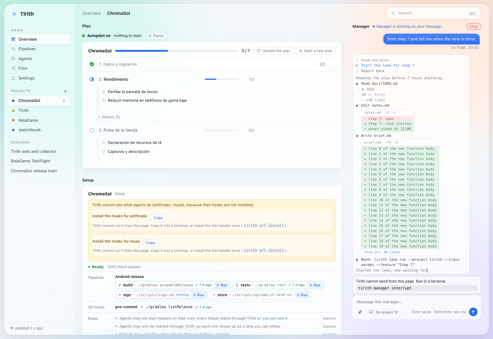
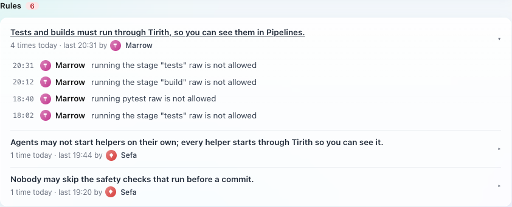
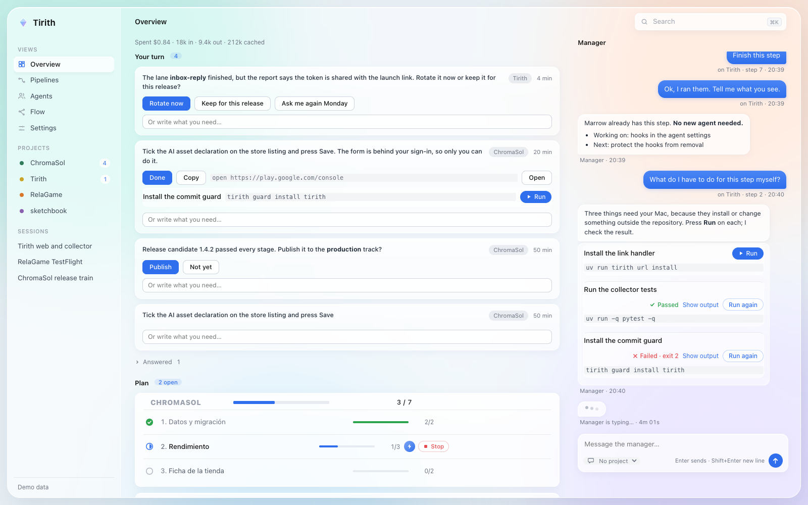
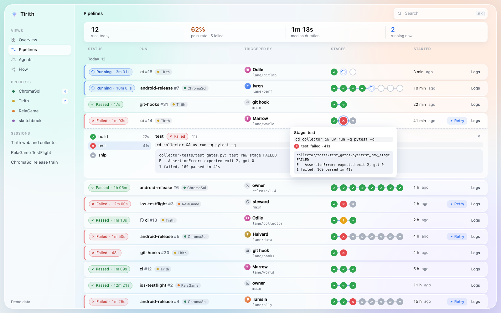
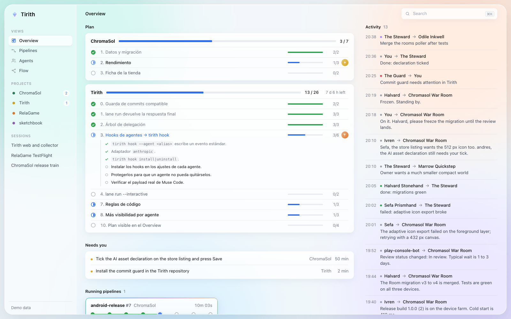
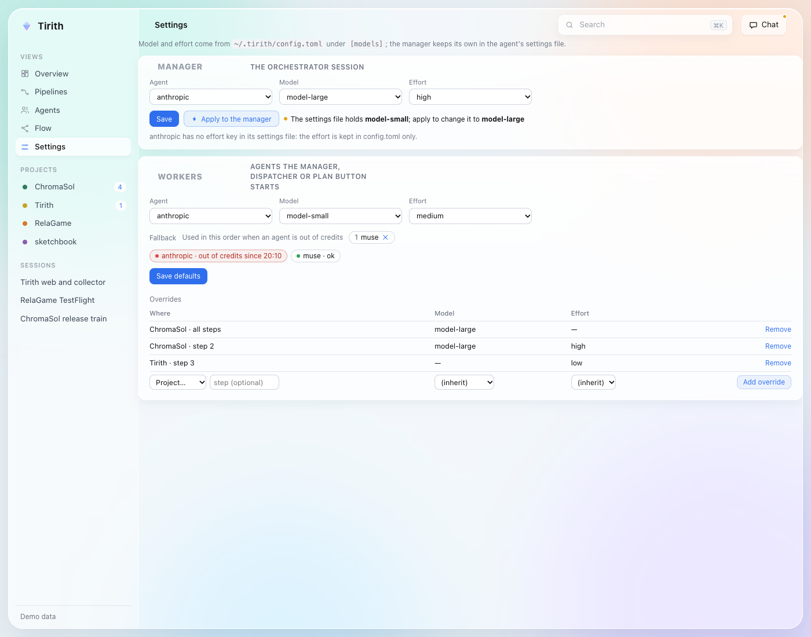

# Tirith

**An autonomous manager for your coding agents. They finish the plan; you see everything and decide only what only you can.**

Landing page: https://andreseloysv.github.io/Tirith/

- **Problem.** You run several coding agents at once. You ask "what is everyone doing?" all day, you
  re-explain the rules, and the agents ask you things they could settle themselves.
- **Solution.** Tirith keeps a plan, starts agents only from plan items, checks what they report, merges what
  passes and answers questions in a chat. Rules are code that blocks, not text the agent may ignore.
- **Result.** You open the app, see what runs and what is done, and are asked only what needs you: a password,
  a payment, a choice that is yours.



Built for the Meta Global AI Developer Hackathon (track: Build for Your World).
**Everything in this repository was created during the hackathon, starting 2026-10-28.**
Submission text for the judges: [`docs/SUBMISSION.md`](docs/SUBMISSION.md).

## What it does

Every item below is on `main`; the contract file named next to it says exactly how it works.

### Plan-driven

- **Agents start only from a plan item.** `tirith lane run` and `tirith launch` refuse to start without an open
  item of the project's plan (`--step N --item "..."`). No item, no agent. ([`CONTRACT-roadmap.md`](docs/CONTRACT-roadmap.md), [`CONTRACT-launch.md`](docs/CONTRACT-launch.md))
- **Every agent reports an outcome** (`tirith plan report --status done|partial|blocked`). A lane that ends without one is not merged; its item is reopened and it is started once more.
- **Tirith is the only plan writer.** Agents cannot edit the plan file (the `roadmap-edit` rule); they ask Tirith with `tirith plan add`.
- **Items are ticked when the work is on `main`**, not when an agent says so.
- **No duplicate agents** on the same plan item.

### Rules in code

Each rule is checked by code, in a hook that runs before the agent's tool call, and the refusal tells the agent
the exact command to use instead ([`CONTRACT-gates.md`](docs/CONTRACT-gates.md)). In plain words:

- Tests and builds run through Tirith (`tirith run --stage ...`), so they show up in Pipelines.
- An agent may not start another agent or its own sub-agents; helpers start through Tirith so you can see them.
- Nobody skips the checks that run before a commit (`--no-verify`, `core.hooksPath`, `.git/hooks` are blocked).
- Agents may not edit the plan, the agents' settings files or Tirith's config.
- A lane starts only with a written brief, a passing project check and an intact commit guard.
- Custom rules per project in `tirith.toml`, enforced the same way.
- **Owner gate:** nothing reaches you unless only you can do it (credentials, payment, personal account,
  physical device, your decision). Everything else goes to the manager. ([`CONTRACT-inbox.md`](docs/CONTRACT-inbox.md))
- **Claim check:** before a merge, the agent's report is compared with the real change: files it says it
  changed, tests it says it added, "tests pass" against a recorded test run. A false claim blocks the merge
  and sends the lane back. No model is involved; it is regexes and git. ([`CONTRACT-launch.md`](docs/CONTRACT-launch.md))



### Autonomy

- **An on-call manager in the chat.** Write to it in the app. One persistent manager session owned by the
  collector answers, delegates to sub-agents and keeps notes.
- **Self-check that heals itself.** Every pass Tirith checks the collector, the manager, the autopilot, the
  disk and the reviews, fixes what it safely can, and raises one item when it cannot. The header has a health dot. ([`CONTRACT-selfcheck.md`](docs/CONTRACT-selfcheck.md))
- **Auto-merge.** A finished lane is tested, claim-checked and merged without asking you; merging is never an owner question.
- **Disk guard** removes merged worktrees when free space runs low.
- **The collector reloads itself** when its code changes on `main`.
- **Timeouts for every command** Tirith starts (git, stages, agents), learned from history, with the process
  group stopped and its locks cleaned up. ([`CONTRACT-timeouts.md`](docs/CONTRACT-timeouts.md))
- **Out of credits?** Work continues with the next agent in your fallback list.

### Visibility

- **Chat** that shows the manager's work live, in the style of a CLI: plan steps, file reads, diffs, commands.
- **Overview:** your turn (with buttons, not questions), the plan per project, the activity feed.
- **Agents:** every lane, its summary, log, review state and "Claims verified".
- **Pipelines**, GitLab-style: runs, stages, durations, logs, retry.
- **Plan** with a progress bar per step, a deadline countdown, and "Start an agent now" on each open step.





### Desktop app

A [Tauri](app/README.md) app, **signed and notarized for macOS** (`scripts/notarize-macos.sh`). It keeps the
collector running, so closing the terminal never kills your lanes. Chat with photos and files, per-project
environment variables ([`CONTRACT-projenv.md`](docs/CONTRACT-projenv.md)), and the model and effort for the
manager and for workers, per project or per step, with a fallback chain
([`CONTRACT-models.md`](docs/CONTRACT-models.md)). No servers and no ports: the app and the page talk through
local files and Tauri IPC.



## How Meta's models are used

- **Muse Spark** (`muse-spark-1.3`, Meta Model API) is the brain, in `collector/tirith/brain.py`. Six jobs,
  each cached by input hash:
  1. a one-sentence summary of each agent's recent log;
  2. a detector for things that need the owner;
  3. an architecture map of a project from its file tree and key files;
  4. a lasting epithet for each agent;
  5. a one-line summary of each chat room;
  6. a "needs the owner" check on room messages.

  The key is read only from the environment (`META_SI_API_KEY` or `META_API_KEY`) and is never logged or
  stored. Without a key everything still works, with plain log lines.
- **Muse Code** is a first-class agent alias (`muse`). `tirith lane run --agent muse` builds its headless
  `exec --json` command, reads its real output stream (captured from a real run and covered by a test), shows
  its steps live and takes its final answer as the lane's report. Hooks for Muse Code install with
  `tirith hook install --agent muse`, and the same rules apply to it as to every agent. If another agent runs out of
  credits, `muse` can be the fallback in `[models.workers]`.
- Muse Code agents built part of Tirith during the hackathon; the rest was built with other coding agents
  after the Muse Code quota ran out. The commit history shows it.

## Try it

Easiest, no agents needed:

```bash
git clone https://github.com/andreseloysv/Tirith && cd Tirith
./run --demo     # the page on demo data (the screenshots above), no collector
```

With your own agents:

```bash
./run            # collector in the background + Tirith in your browser (data from ~/.tirith)
```

Requirements: [uv](https://docs.astral.sh/uv/) and a browser. Set `META_SI_API_KEY` to switch the Muse Spark
brain on. The desktop app is built from `app/` (`npm run tauri dev`, see [`app/README.md`](app/README.md)); the
notarized macOS build comes from `scripts/notarize-macos.sh`.

Tests: `cd collector && uv run pytest -q` (900+ test functions in `collector/tests/`).
Inside a project that has a `tirith.toml`, tests run as `tirith run --project tirith --stage test`.

## How it works

```
 agents (lanes, one git worktree each)         you
   │  hooks: tirith hook → events.jsonl         │  chat · buttons · inbox
   ▼                                            ▼
 collector (every 2 s) ── dispatcher ── manager session
   │   gates · plan · claim check · self-check · auto-merge
   ▼
 ~/.tirith/state.json + state.js ──► web page / desktop app (read-only view, no server, no port)
```

- The **collector** (`collector/`, Python with uv) reads events, lanes, pipelines and the plan, and writes one state file.
- The **page** (`web/`, plain HTML and JS) and the **app** (`app/`) follow that file. Nothing listens on a port.
- Each **lane** is an agent in its own git worktree and branch (`lane/<id>`); the commit guard and the hooks
  are the barrier, not the agent's good will.
- The **inbox** (`~/.tirith/inbox.jsonl`) is how buttons and chat reach the manager: one line in a local file.
- The data contracts are `docs/CONTRACT-*.md`.

## Status

Under construction, honestly. What is described above runs today on `main`.

**In progress** (lanes running now, not shipped yet):

- agents run with no permission prompts, with hooks as the only barrier;
- a continue-until-done loop for lanes;
- a single merge queue;
- faster tests and smaller plan items;
- autopilot proposals that go to the manager;
- a fix so the persistent manager always starts;
- chat with Muse Code through `muse serve` (blocked on its protocol).

Optional extra: a 3D citadel of your agents in Godot 4.7 (`./run --3d`, folder `world/`). It reads the same state file.

Layout: `collector/` CLI and collector · `web/` page · `app/` desktop app · `rust/` Rust port in progress ·
`world/` optional 3D · `fixtures/` demo state · `docs/` contracts.
